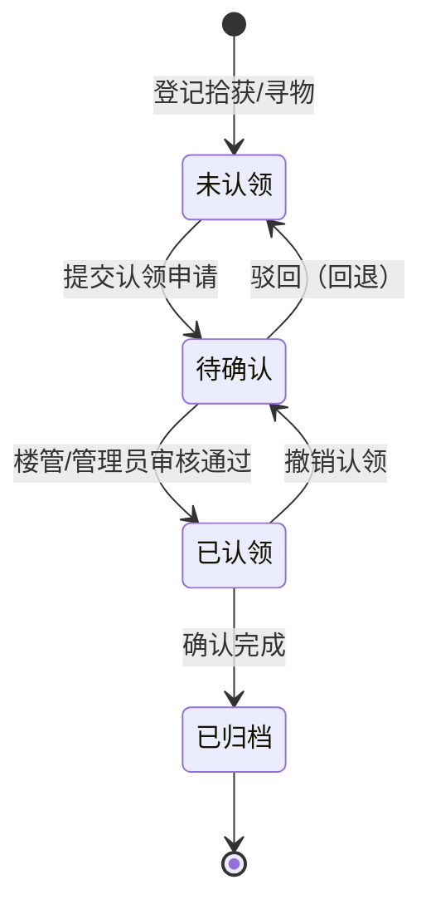

# 校园失物招领信息平台

面向校园网内网的失物招领系统，实现 **拾获登记 → 信息发布 → 检索匹配 → 认领确认 → 结果归档** 的完整业务闭环，全流程状态可追溯、操作有日志。

## 技术栈

| 层次 | 选型 |
|---|---|
| 后端 | Python 3 + Flask 3.0（应用工厂 + 蓝图）、Flask-SQLAlchemy、Flask-Migrate、Flask-Login、Flask-WTF |
| 前端 | Vue 3 + Vite + Vue Router + Pinia + Axios + Element Plus |
| 数据库 | MySQL 8.0（库名 `campus_lostfound`，PyMySQL 驱动） |
| 部署 | Windows：waitress + Nginx；Linux：gunicorn + systemd + Nginx |

## 核心设计

**物品状态机**（含驳回回退与撤销分支）：



**六因子加权匹配算法**：类别 0.25 / 关键词 0.20 / 地点 0.15 / 时间 0.15 / 物品特征 0.15 / 文本相似度 0.10，阈值 0.45；因子得分明细存 JSON，匹配结果可解释、可复核。

## 目录结构

```
campus-lost-found/
├─ server/                 后端（端口 5000，只出 JSON，前缀 /api/v1）
│  ├─ app/
│  │  ├─ models/           数据访问层-实体（11 张表）
│  │  ├─ repositories/     数据访问层-查询封装
│  │  ├─ services/         业务逻辑层（状态机、匹配算法、认证、统计、日志）
│  │  ├─ blueprints/       表现层（main/auth/items/claims/notify/admin）
│  │  ├─ config.py  extensions.py  utils.py  schemas.py  decorators.py
│  ├─ scripts/             init_db.py / seed_demo.py / smoke_test.py / export_init_sql.py
│  ├─ sql/                 schema.sql / init_data.sql
│  ├─ tests/               pytest 用例（39 条）
│  └─ run.py  requirements.txt  .env
├─ web/                    前端（端口 5173）
│  └─ src/{api,views,components,router,stores,styles}
├─ docs/                   需求、数据库、接口、算法、部署 5 篇文档
└─ deploy/                 nginx 配置、waitress 启动脚本、systemd 单元
```

## 快速开始

```bash
# 1) 后端依赖
cd server
python -m venv .venv
.venv/Scripts/python.exe -m pip install -r requirements.txt
copy .env.example .env          # 编辑 .env，将 DATABASE_URL 改为你本机 MySQL 的账号密码

# 2) 建库建表 + 演示数据（自动配图：优先 Pexels 真实照片，断网回退示意图）
.venv/Scripts/python.exe scripts/init_db.py
.venv/Scripts/python.exe scripts/seed_demo.py --reset
# 仅重新抓图：python scripts/fetch_real_images.py [--force]
# 图片来源与许可见 docs/06-图片来源.md

# 3) 启动后端
.venv/Scripts/python.exe run.py        # http://127.0.0.1:5000

# 4) 启动前端（另开终端）
cd ../web
npm install
npm run dev                            # http://127.0.0.1:5173
```

## 演示账号

| 角色 | 账号 | 密码 | 说明 |
|---|---|---|---|
| 系统管理员 | admin | Admin@12345 | 全部后台权限，含管理员管理 |
| 系统管理员 | sysadmin | SysAdmin@2026 | 用于在「管理员管理」页演示多管理员互相管理 |
| 楼管/保卫处 | staff01 | Staff@123 | 可登记拾获、审核认领、看统计 |
| 楼管/保卫处 | staff02 | Staff@2026 | 同上 |
| 学生 | zhangsan / lisi / wangwu | Student@123 | 发布寻物、提交认领 |

新增管理账号（无需登录后台，运维入口）：

```bash
.venv/Scripts/python.exe scripts/create_admin.py --list
.venv/Scripts/python.exe scripts/create_admin.py -u sysadmin -p SysAdmin@2026 -r admin -n 张管理
```

## 验证

```bash
# 端到端冒烟测试（18 步业务闭环）
.venv/Scripts/python.exe scripts/smoke_test.py

# 单元与集成测试（58 条）
.venv/Scripts/python.exe -m pytest tests -q
```

## 文档

- `docs/01-需求与用例.md`
- `docs/02-数据库设计.md`
- `docs/03-接口文档.md`
- `docs/04-算法与状态机.md`
- `docs/05-部署文档.md`
